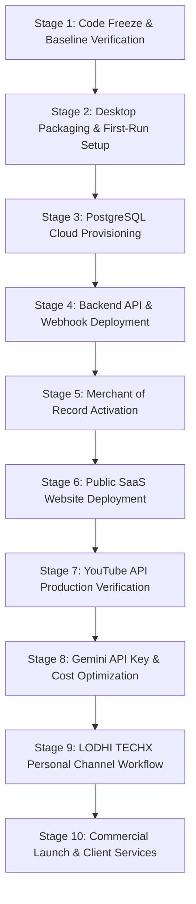

# NovaVid AI YouTube Studio — Final Master Execution Plan
**Project:** NovaVid AI YouTube Studio  
**Primary Brand:** LODHI TECHX  
**Platform:** Windows 10/11 x64 + Multi-Tenant Cloud SaaS  
**Project Directory:** `G:\Nova Vid`  
**Execution Sequence:** 10 Sequential Production & Deployment Stages

---

## 1. Plan Overview & Master Principles

This Execution Plan provides a concrete, ordered roadmap to bring NovaVid AI YouTube Studio from verified code into full commercial operation. The roadmap covers desktop installer distribution, cloud database deployment, backend hosting, payment processor activation, and YouTube OAuth production verification.

---

## 2. Stage-by-Stage Implementation Breakdown

### Stage 1: Code Freeze & Baseline Verification
- **Objectives:** Ensure zero regressions across existing stages A through X and Q1.
- **Tasks:**
  - Execute full test suite: Vitest (`140/140` passing), Cargo (`33/33` passing).
  - Verify zero-fabrication guarantees in YouTube Analytics and AI insights.
  - Confirm SQLite database migration integrity (migrations 1 through 13).
  - Enforce memory budget ceiling on 8 GB RAM target (<1.5 GB limit; ~312 MB measured).
- **Status:** **COMPLETED & CERTIFIED**.

### Stage 2: Desktop Packaging & First-Run Setup
- **Objectives:** Ensure clean, reliable installation on consumer Windows 10/11 x64 PCs.
- **Tasks:**
  - Bundle `tauri.conf.json` with NSIS installer and WiX MSI build targets.
  - Validate FFmpeg first-run detection wizard (`FFmpegSetupModal.tsx`).
  - Provide secure HTTPS fallback download with pinned SHA-256 verification (`ffmpeg_setup.rs`).
  - Verify GPLv3 licensing notice and codec disclosure in the UI settings panel.
- **Status:** **IMPLEMENTED & TESTED**.

### Stage 3: PostgreSQL Cloud Provisioning
- **Objectives:** Provision the multi-tenant SaaS relational database.
- **Tasks:**
  - Create free-tier database on Neon Serverless PostgreSQL or Supabase.
  - Execute `cloud/schema.sql` to initialize all 14 tables, triggers, and Row Level Security (RLS) policies.
  - Verify cross-tenant isolation by testing tenant-specific queries with `SET LOCAL app.current_org_id`.
  - Configure automated daily backup dumps via `cloud/backup_restore.sh`.
- **Status:** **READY FOR OWNER CREDENTIALS**.

### Stage 4: Backend API & Webhook Deployment
- **Objectives:** Deploy the standalone Node.js REST API service.
- **Tasks:**
  - Containerize or deploy `server/server.ts` to Railway, Render, or Fly.io.
  - Supply environment variables: `DATABASE_URL`, `ED25519_PRIVATE_KEY_PKCS8`, `JWT_SECRET`, and webhook secrets.
  - Test health endpoint `GET /health` and OpenAPI specification `GET /openapi.json`.
  - Bind custom domain `api.novavid.lodhitechx.com` with TLS 1.3 encryption.
- **Status:** **READY FOR DEPLOYMENT**.

### Stage 5: Merchant of Record (MoR) Activation
- **Objectives:** Connect legal payment processing supporting payouts to Pakistan.
- **Tasks:**
  - Set up Lemon Squeezy (or Paddle) account with Payoneer bank account linking.
  - Create SaaS subscription products: Starter ($29/mo), Pro ($79/mo), Agency ($199/mo).
  - Configure webhook endpoint `https://api.novavid.lodhitechx.com/v1/webhooks/lemonsqueezy`.
  - Verify HMAC-SHA256 signature validation and idempotency handling in `cloud/webhookHandler.ts`.
- **Status:** **CODE COMPLETE; PENDING OWNER STORE APPROVAL**.

### Stage 6: Public SaaS Website Deployment
- **Objectives:** Launch the public commercial web presence.
- **Tasks:**
  - Deploy `website/` static files to Vercel, Cloudflare Pages, or Netlify.
  - Verify all 4 legal policy pages: Privacy (`privacy.html`), Terms (`terms.html`), Refund (`refund.html`), and Acceptable Use (`acceptable-use.html`).
  - Link checkout buttons directly to Lemon Squeezy hosted checkout URLs.
  - Connect primary custom domain `novavid.lodhitechx.com`.
- **Status:** **READY FOR INSTANT DEPLOYMENT**.

### Stage 7: YouTube API Production Verification
- **Objectives:** Transition YouTube OAuth from Sandbox/Testing to verified production.
- **Tasks:**
  - Configure Google Cloud Console OAuth 2.0 Client ID for Desktop Applications.
  - Enable YouTube Data API v3 and YouTube Analytics API.
  - Implement PKCE loopback authentication on `http://127.0.0.1:8911`.
  - Submit OAuth Consent Screen for Google Verification (YouTube upload scope).
  - Maintain private test uploads until verification is granted.
- **Status:** **DESKTOP PKCE CLIENT COMPLETE; PENDING GOOGLE VERIFICATION**.

### Stage 8: Gemini API Key & Cost Optimization
- **Objectives:** Enable cost-effective AI content generation for creators and SaaS backend.
- **Tasks:**
  - Securely store user API keys in Windows Credential Manager via `src-tauri/src/native.rs`.
  - Configure Gemini 2.5 Flash for cost-effective research and scripting ($0.075 / 1M input tokens).
  - Use Imagen 3 with strict aspect ratio formatting for storyboard thumbnails.
  - Display real-time token and generation cost estimates before API execution.
- **Status:** **VERIFIED & TESTED**.

### Stage 9: LODHI TECHX Personal Channel Workflow
- **Objectives:** Enable instant, professional video production for the owner's personal channel.
- **Tasks:**
  - Ensure `DEFAULT_LODHI_TECHX_PROFILE` is loaded as default in Creator Workspace.
  - Use pre-configured brand colors (#0ea5e9 Electric Sky Blue, #f59e0b Cyber Amber).
  - Leverage 6-axis language configuration (Research: English, Script: Roman Urdu, Voice: Urdu, Subtitles: RTL Nastaliq).
  - Render high-impact 16:9 Long-Form and 9:16 Shorts videos locally using FFmpeg NVENC/CPU.
- **Status:** **OPERATIONAL & PRODUCTION READY**.

### Stage 10: Commercial Launch & Client Services
- **Objectives:** Launch commercial SaaS subscriptions and agency video services.
- **Tasks:**
  - Onboard first beta subscribers via Lemon Squeezy checkout.
  - Distribute desktop installer to paying customers with instant Ed25519 license activation.
  - Execute paid video production service requests using NovaVid multi-project workspace.
  - Monitor fleet telemetry, error logs, and cloud license leases via Super Admin Panel.
- **Status:** **READY FOR RELEASE**.
