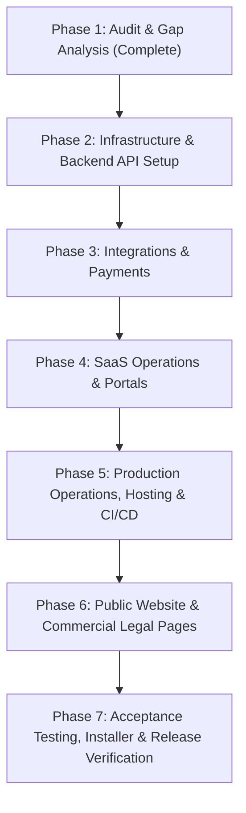

# NovaVid AI YouTube Studio — Final Production Roadmap
## Sequential Execution Plan: From Existing Baseline to Commercial Production Launch

**Project:** NovaVid AI YouTube Studio  
**Product Version:** 0.1.0 Commercial → Production Release  
**Platform:** Windows 10/11 x64 Desktop + Multi-Tenant Cloud SaaS  
**Primary Brand:** LODHI TECHX  
**Execution Mode:** Autonomous Sequential Phases (Strict Project Preservation)  

---

## Phase Breakdown & Execution Sequence

---

### Phase 1 — Inspection & Gap Analysis (Completed)
- [x] Inspect existing desktop implementation (Stages A–V, Q1, R–X).
- [x] Audit SQLite migrations (`0001`–`0013`) and confirm 8 GB RAM hardening (58.08 MB working set).
- [x] Audit existing cloud modules (`cloud/schema.sql`, `cloud/webhookHandler.ts`, `cloud/keys.ts`).
- [x] Publish `FINAL_PRODUCTION_GAP_AUDIT.md`.
- [x] Publish `FINAL_PRODUCTION_ROADMAP.md`.

---

### Phase 2 — Cloud Infrastructure & Standalone Backend API
- [ ] **Complete PostgreSQL Schema (`cloud/schema.sql`):**
  - Add missing tables: `plans`, `organization_members`, `payment_transactions`, `projects` (cloud), `cloud_sync_queue`, `support_requests`.
  - Apply strict Row Level Security (RLS) policies and cross-tenant isolation constraints.
- [ ] **Build Production Backend API Service (`server/`):**
  - Implement real Node/TypeScript HTTP service with modular route handlers:
    - `POST /api/v1/auth/register`, `POST /api/v1/auth/login`, `GET /api/v1/auth/me`
    - `GET /api/v1/plans` (configurable tiers & quotas)
    - `POST /api/v1/sync` (batch push/pull hybrid sync with conflict resolution)
    - `POST /api/v1/licenses/activate`, `GET /api/v1/licenses/verify`
    - `POST /api/v1/devices/unbind`
    - `POST /api/v1/usage/report`
    - `POST /api/v1/webhooks/billing` (LemonSqueezy, Stripe, Paddle)
    - `GET /api/v1/admin/fleet`, `POST /api/v1/admin/license/issue`
    - `POST /api/v1/support/ticket`
    - `GET /api/v1/health` (liveness, readiness, DB status)
  - Generate OpenAPI 3.0 specification (`server/openapi.json`).
  - Add automated backend test suite (`server/server.test.ts`).

---

### Phase 3 — Integrations & Payment Gateway Setup
- [ ] **Gemini API Setup & Audit:**
  - Secure Windows Credential Manager storage verification.
  - Document user consent, billing transparency, and model quota limits in `GEMINI_API_SETUP.md`.
- [ ] **YouTube OAuth 2.0 PKCE & Publishing:**
  - Loopback server and 1 MiB chunked resumable upload verification.
  - Document Google Cloud project setup, scopes, and verification in `YOUTUBE_OAUTH_SETUP.md`.
- [ ] **Pakistan Merchant Payment Strategy:**
  - In-depth evaluation of Lemon Squeezy and Paddle as primary Merchants of Record (MoR) for Pakistan-based business.
  - Document compliant banking & payout setup in `PAYMENT_GATEWAY_SETUP.md`.
- [ ] **Ed25519 Cryptographic Licensing:**
  - Keep private key exclusively in backend service; embed public key in desktop client.

---

### Phase 4 — SaaS Operations & Portal Integration
- [ ] **Admin SaaS Panel (`src/components/AdminSaaSPanel.tsx`):**
  - Wire to real backend API endpoints for live MRR, active subscriber count, and license issuance.
- [ ] **Customer SaaS Portal (`src/components/CustomerSaaSPanel.tsx`):**
  - Wire to backend for live subscription status, device seat unbinding, and resource meters.
- [ ] **In-App Customer Support & Feedback:**
  - Support ticket submission modal wired to backend database.

---

### Phase 5 — Production Operations, Hosting & CI/CD
- [ ] **Zero-Cost / Low-Cost Cloud Deployment Configuration:**
  - Managed PostgreSQL: Neon / Supabase free tier guide.
  - Backend API: Railway / Render / Cloudflare Workers deployment guide.
  - Publish `CLOUD_DEPLOYMENT_GUIDE.md` and `PRODUCTION_DATABASE_SETUP.md`.
- [ ] **Secrets & Configuration:**
  - Create comprehensive `.env.example` template with zero hardcoded credentials.
- [ ] **Automated CI/CD Workflow:**
  - Create `.github/workflows/ci.yml` running lint, TypeScript compile, Vitest, and Cargo tests.
- [ ] **Disaster Recovery & Backup Automation:**
  - PostgreSQL automated backup & restore script (`cloud/backup_restore.sh`).
  - Publish `BACKUP_DISASTER_RECOVERY.md`.

---

### Phase 6 — Public Website & Legal Documentation
- [ ] **Public Web Application (`website/`):**
  - Build responsive standalone public website for LODHI TECHX brand:
    - Landing page (Hero, Video Demos, Feature Highlights).
    - Pricing tables (Free, Pro Studio, Agency/Enterprise).
    - Download page (Windows 10/11 x64 installer links).
    - Documentation & FAQ.
    - Customer Portal login.
    - Legal Policies: Privacy Policy, Terms of Service, Refund Policy, Acceptable Use Policy.

---

### Phase 7 — Beta Testing, Packaging & Acceptance Verification
- [ ] **End-to-End Acceptance Verification Script (`scripts/test_runtime_e2e_acceptance.ps1`):**
  - Automate testing of all 22 required acceptance criteria.
- [ ] **Windows Packaging Verification:**
  - Verify NSIS & WiX MSI installer configuration in `src-tauri/tauri.conf.json`.
- [ ] **Formal Delivery Documentation:**
  - `CUSTOMER_USER_GUIDE.md`
  - `ADMIN_USER_GUIDE.md`
  - `BETA_TEST_REPORT.md`
  - `FINAL_COMMERCIAL_RELEASE_REPORT.md`
