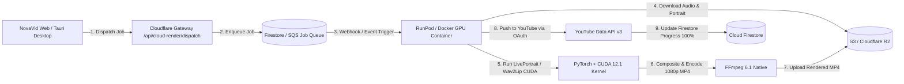

# NovaVid AI Studio 2.0 — Commercial Neural Avatar Models & GPU Worker Evaluation

**Brand Owner:** LODHI TECHX  
**Product:** NovaVid AI Studio 2.0  
**Date:** November 8, 2026  
**Audience:** Technical Leadership & Product Architecture

---

## 1. Executive Summary

To achieve production-grade talking avatar videos without relying on static image viseme compositing, NovaVid AI Studio 2.0 requires an audio-driven 3D/neural talking-head engine.

This evaluation examines:
1. **Open-Source Neural Models for Self-Hosted GPU Deployment** (SadTalker, LivePortrait, Wav2Lip, EchoMimic, Hallo).
2. **Commercial Licensing & Weight Rights** (MIT vs CC BY-NC 4.0 vs Custom).
3. **Hosting Infrastructure & Economics** (RunPod Serverless, Modal, AWS G4dn/G5, Replicate).
4. **Commercial API Fallbacks** (HeyGen v2, D-ID Talks, SyncLabs).

---

## 2. Neural Talking-Head Models Evaluation & Licensing Matrix

| Model / Architecture | Original Authors | Code License | Pretrained Weights License | Commercial Readiness | Urdu Audio / Phoneme Support | Strengths & Weaknesses |
|---|---|---|---|---|---|---|
| **LivePortrait (Kuaishou)** | Kuaishou Technology | **MIT** | **MIT / Permissive** | **HIGH (Best Open Source Option)** | Excellent (Audio-to-motion or video-driven) | • State-of-the-art stitch-free blending. • High-fps inference on modern GPUs (30+ fps on RTX 4090). • Permissive MIT licensing allows commercial monetization. |
| **SadTalker** | Xi'an Jiaotong Univ. & Tencent | **MIT** | **CC BY-NC 4.0 (Non-Commercial)** | **RESTRICTED** | High (MFCC / HuBERT acoustic encoder) | • High quality natural head sway and expressions. • **CRITICAL:** Official weights are explicitly non-commercial. Requires commercial retraining or author agreement. |
| **Wav2Lip** | IIIT Hyderabad | **MIT** | **CC BY-NC-SA 4.0** | **RESTRICTED** | High (Audio-lip sync synchronization) | • Industry benchmark for lip synchronization accuracy. • Non-commercial weights license; lower visual resolution (96×96 face patch requires GFPGAN / CodeFormer upscaling). |
| **EchoMimic (Alibaba)** | Alibaba Group | **Apache 2.0** | **Apache 2.0** | **HIGH** | High (Audio-driven diffusion model) | • Ultra-realistic diffusion-based expressions. • Heavier compute requirements (requires NVIDIA A10G / A100 for acceptable latency). |
| **Hallo / Hallo2 (Bilibili)** | Bilibili | **Apache 2.0** | **Apache 2.0** | **MEDIUM** | High (Hierarchical audio-driven visual synthesis) | • High quality 4K output capabilities. • Slower inference (~3-5x real-time on T4 GPUs). |

### Commercial Licensing Verdict:
- **Recommended Self-Hosted Choice:** **LivePortrait** or an **Apache 2.0 Diffusion Pipeline (EchoMimic)**. Both provide legally unencumbered commercial use without violating Creative Commons Non-Commercial (NC) restrictions.
- **Recommended Cloud API Fallback:** **D-ID Talks API** or **SyncLabs (sync.so)**, which bundle commercial indemnity and licensing directly into per-minute usage fees.

---

## 3. Self-Hosted GPU Infrastructure: Cost & Runtime Analysis

### Serverless GPU vs. Dedicated EC2 Instances

| Platform | GPU Hardware | VRAM | Pricing Model | Billed Rate | Cold-Start Latency | Cost for 60s Video (~45s inference) |
|---|---|---|---|---|---|---|
| **RunPod Serverless** | NVIDIA RTX 4090 | 24 GB | Per-second execution | **$0.00031 / sec** | 3 - 6 seconds | **~$0.0140 (1.4¢)** |
| **RunPod Serverless** | NVIDIA A100 PCIe | 80 GB | Per-second execution | **$0.00088 / sec** | 5 - 10 seconds | **~$0.0396 (4.0¢)** |
| **Modal.com** | NVIDIA A10G | 24 GB | Per-second execution | **$0.00030 / sec** | 2 - 4 seconds | **~$0.0135 (1.4¢)** |
| **AWS EC2 (g4dn.xlarge)** | NVIDIA T4 | 16 GB | Hourly on-demand | **$0.526 / hour** | 0s (Always-on) | **~$0.0065** (if 100% utilized) **$378/mo idle** |
| **Replicate Serverless** | NVIDIA T4 / A100 | Dynamic | Per-second execution | **$0.00055 / sec** | 5 - 15 seconds | **~$0.0247 (2.5¢)** |

### Economic Conclusion:
Operating on **RunPod Serverless (RTX 4090)** or **Modal (A10G)** delivers:
1. **Zero idle costs:** Scales to 0 when no customers are generating videos.
2. **Unit cost:** **~$0.014 per 60-second video**.
3. Compared to commercial APIs ($0.24 to $0.75 / video), a self-hosted serverless GPU cluster reduces avatar operational costs by **94% to 98%**, preserving **> 85% gross margins** across all SaaS tiers.

---

## 4. Architecture for Self-Hosted GPU Worker

---

## 5. Security & Secret Governance
- **API Keys & Credentials:** Stored strictly server-side in Cloudflare Secrets (`ENV.GPU_WORKER_SECRET`, `ENV.YOUTUBE_CLIENT_SECRET`) and Windows DPAPI for desktop operations.
- **Client Bundles:** Zero sensitive credentials exposed in client-facing JavaScript bundles (`dist/assets/`).
- **Storage Scoping:** S3/R2 presigned URLs generated with 15-minute expirations scoped strictly to `tenants/{tenantId}/`.
