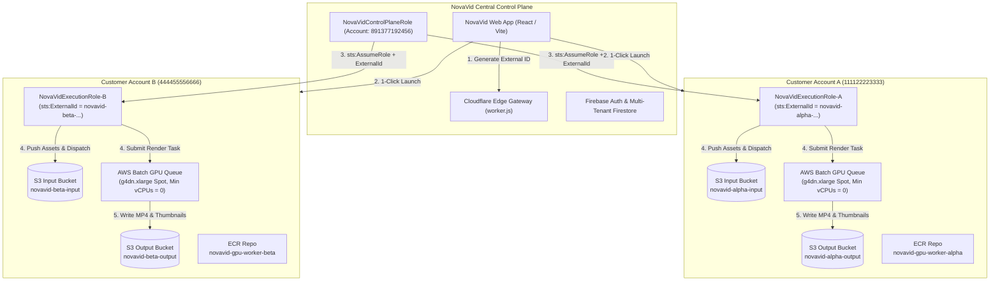

# NOVAVID AI STUDIO 2.0 — CUSTOMER-OWNED AWS ARCHITECTURE (OPTION B)

**Brand Owner:** LODHI TECHX  
**Product:** NovaVid AI Studio 2.0  
**Architectural Model:** 100% Bring Your Own AWS Account (BYOA)  
**Document Version:** 2.1.0  
**Effective Date:** 2026-11-08  

---

## 1. ARCHITECTURAL DECISION & FOUNDATIONAL PRINCIPLES

Under **Option B — Customer-Owned AWS Only**, every NovaVid user—including the founder/owner (Umar Hayat / LODHI TECHX) and third-party SaaS customers—provisions and connects their own dedicated AWS account.

### Fundamental Invariants
1. **Zero Shared Infrastructure Billing**: NovaVid never uses the owner's AWS account or credit card to render, process, or store another customer's video content.
2. **Customer Cloud Asset Ownership**: Customers own their S3 buckets, ECR container images, AWS Batch queues, and IAM roles. All AWS usage charges appear directly on the customer's AWS invoice.
3. **Decoupled Lightweight Control Plane**: The NovaVid web application and Cloudflare edge gateway act purely as a control plane for user authentication, project metadata, job orchestration, and telemetry.
4. **Zero Permanent Secrets**: NovaVid never requests, receives, or stores AWS root credentials, IAM user passwords, or permanent AWS `AccessKeyId`/`SecretAccessKey` pairs.
5. **Scale to Zero Idle Cost**: All Batch compute environments configure `minvCpus: 0`. When no rendering jobs are executing, zero EC2 GPU instances exist and zero compute charges accrue.

---

## 2. SYSTEM ARCHITECTURE & TOPOLOGY



---

## 3. COMPONENT SPECIFICATIONS

### 3.1 Cross-Account Trust Policy & External ID
Each customer provisions an IAM Role (`NovaVidExecutionRole-${tenantId}`) with an immutable trust relationship requiring AWS STS temporary token issuance:
```json
{
  "Version": "2012-10-17",
  "Statement": [
    {
      "Effect": "Allow",
      "Principal": {
        "AWS": "arn:aws:iam::891377192456:root"
      },
      "Action": "sts:AssumeRole",
      "Condition": {
        "StringEquals": {
          "sts:ExternalId": "novavid-${tenantId}-${cryptoRandomEntropy}"
        }
      }
    }
  ]
}
```

### 3.2 S3 Media Buckets
- **Raw Input Bucket**: `novavid-${tenantId}-input-${region}`  
  Holds scene images, voiceovers (`.wav`/`.mp3`), and subtitles.
- **Render Output Bucket**: `novavid-${tenantId}-output-${region}`  
  Stores finished MP4 video files, custom thumbnails, and FFprobe audit receipts.
- **Security Profile**: Default SSE-AES256 encryption, PublicAccessBlock enabled across all 4 parameters, and CORS enabled for browser uploads.

### 3.3 AWS Batch GPU Compute Environment
- **Compute Type**: Managed EC2 Spot Instances (with automated fallback to On-Demand).
- **Instance Families**: `g4dn.xlarge` (NVIDIA T4 16GB) or `g5.xlarge` (NVIDIA A10G 24GB).
- **vCPU Bounds**: `minvCpus: 0`, `maxvCpus: 16`, `desiredvCpus: 0`.
- **Scaling Behavior**: Automatically terminates EC2 instances upon queue drain.

### 3.4 ECR Container Repository
- **Name**: `novavid-gpu-worker-${tenantId}`
- **Image**: Based on NVIDIA CUDA 12.4 + FFmpeg 64-bit static runtime.
- **Tag Mutability**: `IMMUTABLE` with automated vulnerability scanning on push.

---

## 4. MULTI-TENANT ISOLATION GUARANTEES

| Threat Vector | NovaVid Protection Mechanism |
|---|---|
| **Confused Deputy Attack** | Unique server-generated `sts:ExternalId` bound to each customer tenant ID. |
| **Cross-Tenant S3 Access** | Execution policy grants access strictly to `arn:aws:s3:::novavid-${TenantId}-*`. No cross-account S3 wildcards. |
| **Queue Injection** | Batch job submission requires tenant-specific queue ARN (`arn:aws:batch:${region}:${account}:job-queue/novavid-gpu-queue-${tenant}`). |
| **Credential Exfiltration** | Zero persistent secrets. Ephemeral STS session tokens expire within 3600 seconds. |
| **Noisy Neighbor / Quota Contention** | Workloads execute in independent customer AWS accounts; quota limits or job failures in Customer A never block Customer B. |

---

## 5. REVENUE & BILLING TRANSPARENCY

- **Direct Invoicing**: Amazon Web Services directly bills the customer's registered payment card for GPU EC2 hours, S3 storage, and data egress.
- **NovaVid Platform Fee**: **$0.00 markup** on customer cloud infrastructure.
- **Cost Dashboard**: Real-time cost forecaster inside NovaVid calculates Spot compute ($0.158/hr) vs On-Demand compute ($0.526/hr) and S3 standard ($0.023/GB/mo).
