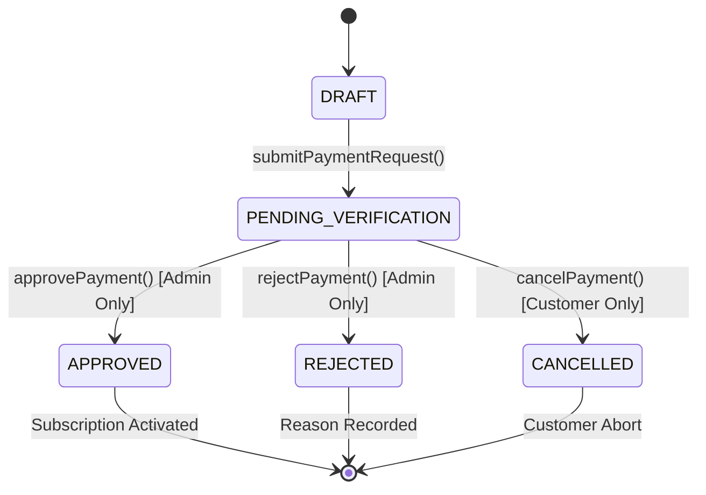

# NOVAVID AI STUDIO 2.0
# MANUAL PAYMENT IMPLEMENTATION REPORT

**Author:** LODHI TECHX Development Team  
**Founder:** Umar Hayat  
**Release Tag:** `v2.0.2-commercial-whatsapp`  
**Engine File:** `src/lib/manualPaymentSystem.ts`  
**UI Modules:** `src/components/CustomerSaaSPanel.tsx`, `src/components/AdminSaaSPanel.tsx`

---

## 1. Engine Architecture

The manual payment pipeline is managed by `ManualPaymentSystem` in [manualPaymentSystem.ts](file:///g:/Nova%20Vid/src/lib/manualPaymentSystem.ts).

### 1.1 State Machine


### 1.2 Anti-Fraud & Transaction Uniqueness
When a customer submits a transaction reference (e.g. `TRX-982143`), the engine normalizes the string to uppercase and registers it in `usedTransactionReferences`. Any secondary submission reusing this reference is rejected immediately with an error:
```
Transaction reference '<TRX>' has already been submitted.
```

### 1.3 Receipt Image Security & Validation
File validation checks:
- **Maximum size:** 5 MB (`5 * 1024 * 1024` bytes).
- **MIME Whitelist:** `image/jpeg`, `image/png`, `image/webp`, `application/pdf`.
- **Extension Whitelist:** `.jpg`, `.jpeg`, `.png`, `.webp`, `.pdf`.
- **Integrity:** Non-empty, valid base64 URI or storage path.

---

## 2. WhatsApp Click-to-Chat URI Construction

Because standard web browsers running on desktop or mobile cannot programmatically insert arbitrary binary files into third-party application sandboxes (WhatsApp Desktop / WhatsApp Web / WhatsApp Mobile), the link provides full order provenance in the message body, accompanied by explicit visual instructions:

```typescript
const cleanNumber = this.settings.whatsappNumber.replace(/[^0-9]/g, "");
const prefilledMessage = [
  `Hello ${this.settings.supportContactName},`,
  ``,
  `I have submitted a manual subscription payment request for NovaVid AI Studio 2.0:`,
  `• Request ID: ${request.id}`,
  `• Plan: ${plan} (${request.billingCycle.toUpperCase()})`,
  `• Amount: ${request.amount.toLocaleString()} ${request.currency}`,
  `• Payment Method: ${request.paymentMethodName}`,
  `• Transaction Reference: ${request.transactionReference}`,
  `• Customer: ${request.customerName} (${request.customerEmail})`,
  `• Organization: ${request.organizationId}`,
  ``,
  `My payment receipt screenshot is attached in this chat.`,
  `Please verify and activate my subscription.`
].join("\n");

const whatsappUrl = `https://wa.me/${cleanNumber}?text=${encodeURIComponent(prefilledMessage)}`;
```

---

## 3. Storage Persistence

The system maintains automatic double-persistence:
- **Web App / Customer Portal:** Browser `localStorage` caches `novavid_whatsapp_settings`, `novavid_manual_payments`, `novavid_manual_subscriptions`, and `novavid_used_trx_refs`.
- **Desktop Application:** Synchronized with local SQLite database schema `saas_subscriptions` and encrypted API credentials via Windows DPAPI.
- **Admin Verification Panel:** Hydrates directly from live storage, allowing immediate verification without server restarts.
